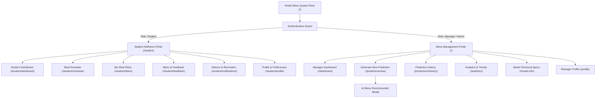

# Comprehensive HCI Wireframe Specifications & Prototype Blueprints

**Project:** College Mess Planning & Food Waste Prediction System  
**System Components:** Student Wellness Portal & Mess Operations Portal  
**Target Design Framework:** Low-to-Mid Fidelity Wireframes, 8-Point Spatial Grid System, WCAG 2.2 AA Compliance  
**Author/Team:** HCI Lab Group  

---

## Table of Contents
1. [Wireframing Principles & Grid System](#1-wireframing-principles--grid-system)
2. [Information Architecture & Site Sitemap](#2-information-architecture--site-sitemap)
3. [Student Portal Wireframes (Desktop & Mobile)](#3-student-portal-wireframes-desktop--mobile)
   - [WF-01: Student Dashboard (Desktop 1280px)](#wf-01-student-dashboard-desktop-1280px)
   - [WF-02: Student Dashboard (Mobile 375px)](#wf-02-student-dashboard-mobile-375px)
   - [WF-03: Meal-Intention State Machine Wireframe](#wf-03-meal-intention-state-machine-wireframe)
   - [WF-04: Meal Schedule & Chronological Planner](#wf-04-meal-schedule--chronological-planner)
   - [WF-05: Menu Feedback & Ratings Form](#wf-05-menu-feedback--ratings-form)
4. [Manager Portal Wireframes](#4-manager-portal-wireframes)
   - [WF-06: Manager Operational Dashboard](#wf-06-manager-operational-dashboard)
   - [WF-07: Prediction Form with Prescriptive AI Menu Recommendation](#wf-07-prediction-form-with-prescriptive-ai-menu-recommendation)
5. [Component Blueprints & Spatial Dimension Tokens](#5-component-blueprints--spatial-dimension-tokens)
6. [Figma & Balsamiq Setup Guide](#6-figma--balsamiq-setup-guide)

---

## 1. Wireframing Principles & Grid System

### 1.1 The 8-Point Spatial Grid
All layout dimensions, margins, paddings, and component heights adhere to an 8-point base grid (with a 4-point sub-grid for micro-spacing):
- **Base Grid:** `4px`, `8px`, `12px`, `16px`, `24px`, `32px`, `48px`, `64px`.
- **Target Touch Dimensions:** Minimum interactive touch target size is `44px × 44px` (WCAG 2.2 AA Success Criterion 2.5.8).
- **Desktop Layout:** 12-column responsive fluid grid, `24px` gutter, `max-width: 1280px`.
- **Mobile Layout:** 4-column fluid grid, `16px` gutter, `16px` outer margin.

### 1.2 Wireframe Annotation Conventions
- `[ ]` : Checkbox or Radio selection element
- `( * )` : Selected radio state
- `(   )` : Unselected radio state
- `[ Button Text ]` : Interactive clickable button
- `|--- Table ---|` : Data table structure
- `[v]` : Dropdown select trigger
- `(H#)` : Annotated Nielsen Usability Heuristic (#1 to #10)

---

## 2. Information Architecture & Site Sitemap



---

## 3. Student Portal Wireframes (Desktop & Mobile)

### WF-01: Student Dashboard (Desktop 1280px)

**Layout Structure:** Compact Left Sidebar (240px) + Header Bar (64px) + Main Content (1000px)

```
+-----------------------------------------------------------------------------------------------------------------------+
|  LOGO: College Mess  |  Top Bar: Wednesday, 22 Oct 2026 | Mess: Hostel Block B Dining Hall | (Bell: 2) | [ Profile v ]  |
+----------------------+------------------------------------------------------------------------------------------------+
| [D] Dashboard (Actv) |  +------------------------------------------------------------------------------------------+  |
| [S] Meal Schedule    |  | Good Morning, Shiva Kumar!                                 [ Plan Today's Meals -> ] (H7)|  |
| [P] My Meal Plans    |  | Today is Wednesday, 22 Oct. You have 1 meal response pending. (H1)                       |  |
| [F] Menu & Feedback  |  +------------------------------------------------------------------------------------------+  |
| [N] Notices (2)      |                                                                                                |
| [U] Profile          |  TODAY'S MEALS & ATTENDANCE INTENTIONS                                  [ View Full Week -> ]  |
|                      |  +---------------------------+  +---------------------------+  +---------------------------+  |
|                      |  | BREAKFAST (7:30 - 9:30 AM)|  | LUNCH (12:30 - 2:30 PM)   |  | DINNER (7:30 - 9:30 PM)   |  |
|                      |  | Cutoff: 6:30 AM (H5)      |  | Cutoff: Today 11:00 AM(H1)|  | Cutoff: Today 6:00 PM (H1)|  |
|                      |  | [ Badge: Response Closed ]|  | [ Badge: Response Pending]|  | [ Badge: Likely to Attend]|  |
|                      |  +---------------------------+  +---------------------------+  +---------------------------+  |
|                      |  | MENU: South Indian        |  | MENU: North Indian Special|  | MENU: Comfort Dinner      |  |
|                      |  | - Idli & Medu Vada        |  | - Paneer Butter Masala    |  | - Phulka, Dal Fry         |  |
|                      |  | - Sambar, Coconut Chutney |  | - Dal Tadka, Jeera Rice   |  | - Aloo Gobi Matar         |  |
|                      |  +---------------------------+  +---------------------------+  +---------------------------+  |
|                      |  | (i) Response Window Closed|  | Will you attend this meal?|  | Registered Intention:     |  |
|                      |  | Cutoff passed for batch   |  | ( * ) Likely to attend (H2|  | [ Badge: Likely to Attend]|  |
|                      |  | preparation. (H5)         |  | (   ) Not likely to attend|  | Saved at 10:45 AM (H1)    |  |
|                      |  |                           |  | (   ) Unsure yet          |  |                           |  |
|                      |  |                           |  | [ Shield: Voluntary note ]|  | [ Edit ]   [ Withdraw ]   |  |
|                      |  |                           |  | [ Confirm Response ] (H1) |  |                           |  |
|                      |  +---------------------------+  +---------------------------+  +---------------------------+  |
|                      |                                                                                                |
|                      |  UPCOMING MEALS (Next 48 Hours)              | MESS NOTICES & REMINDERS                        |
|                      |  +----------------------------------------+  +----------------------------------------------+  |
|                      |  | Thu, 23 Oct - Breakfast (7:30-9:30)    |  | [*] Special Diwali Feast Notice              |  |
|                      |  | Poha, Sprouts, Boiled Egg [Likely]     |  |     Special menu published for Friday dinner.|  |
|                      |  +----------------------------------------+  +----------------------------------------------+  |
|                      |  | Thu, 23 Oct - Lunch (12:30-2:30)       |  | [*] Lunch Cutoff Extended by 15 mins         |  |
|                      |  | Rajma Masala, Steamed Rice [Unsure]    |  |     Kitchen batch begins at 11:15 AM today.  |  |
|                      |  +----------------------------------------+  +----------------------------------------------+  |
|                      |  | Thu, 23 Oct - Dinner (7:30-9:30)       |  | HOW WAS YOUR RECENT MEAL? (H10)              |  |
|                      |  | Egg Curry / Veg Korma [No Intention]   |  | Help the kitchen team improve taste & portion|  |
|                      |  +----------------------------------------+  | [ Leave Quick Feedback -> ]                  |  |
+----------------------+------------------------------------------------------------------------------------------------+
```

---

### WF-02: Student Dashboard (Mobile 375px)

**Layout Structure:** Sticky Top Bar + Scrollable 1-Column Cards + Sticky Bottom Touch Navigation

```
+-------------------------------------------+
| [=] Mess Portal (Block B)    (Bell) [usr] |
+-------------------------------------------+
| Good Morning, Shiva!                      |
| Today is Wed, 22 Oct. 1 response pending. |
| [ Plan Today's Meals v ]                  |
+-------------------------------------------+
| TODAY'S MEAL INTENTIONS                   |
|                                           |
| +---------------------------------------+ |
| | LUNCH (12:30 PM - 2:30 PM)            | |
| | Cutoff: Today at 11:00 AM (H5)        | |
| | Status: [ Response Pending ]          | |
| +---------------------------------------+ |
| | MENU: North Indian Special            | |
| | Paneer Butter Masala, Dal Tadka,      | |
| | Jeera Rice, Phulka, Curd              | |
| +---------------------------------------+ |
| | Will you attend this meal?            | |
| | [x] ( * ) Likely to attend            | |
| | [ ] (   ) Not likely to attend        | |
| | [ ] (   ) Unsure yet                  | |
| |                                       | |
| | (Shield) Helps kitchen avoid waste.   | |
| | [      Confirm Response (48px)     ]  | |
| +---------------------------------------+ |
|                                           |
| +---------------------------------------+ |
| | DINNER (7:30 PM - 9:30 PM)            | |
| | Status: [ Likely to Attend ] (H1)     | |
| | Saved at 10:45 AM | [Change] [Cancel] | |
| +---------------------------------------+ |
|                                           |
| +---------------------------------------+ |
| | BREAKFAST (7:30 AM - 9:30 AM)         | |
| | Status: [ Response Closed ] (H5)      | |
| | Cutoff (6:30 AM) passed for today.    | |
| +---------------------------------------+ |
|                                           |
| NOTICES & FEEDBACK                        |
| [!] Special Diwali Feast planned Fri!    |
| [?] Rate today's Lunch taste & quantity   |
+-------------------------------------------+
| [ Home ]  [ Schedule ]  [ Plans ] [ Menu ]| <- Sticky Touch Bar (56px)
+-------------------------------------------+
```

---

### WF-03: Meal-Intention State Machine Wireframe

```
        +-------------------------------------------------------------+
        |                 INITIAL STATE: NO RESPONSE                  |
        | [ ( ) Likely ]   [ ( ) Not Likely ]   [ ( ) Unsure ]        |
        | [ Confirm Response (Disabled: opacity 0.5) ]                |
        +-------------------------------------------------------------+
                                      |
                     User taps "Likely to attend"
                                      v
        +-------------------------------------------------------------+
        |                SELECTION ACTIVE (UNSAVED)                   |
        | [ (*) Likely (Forest Ring) ] [ ( ) Not Likely ] [ ( ) Unsure|
        | [ Confirm Response (Active Green, Focus Ring) ]             |
        +-------------------------------------------------------------+
                                      |
                     User taps "Confirm Response"
                                      v
        +-------------------------------------------------------------+
        |                   ASYNCHRONOUS SAVING                       |
        | [ Spinner ] "Confirming intention with kitchen..." (H1)     |
        | Buttons disabled to prevent duplicate submission (H5)       |
        +-------------------------------------------------------------+
                   |                                     |
               Success (200 OK)                     Network Error (500)
                   v                                     v
+-----------------------------------+  +-----------------------------------+
|       CONFIRMED SAVED STATE       |  |         RECOVERABLE ERROR         |
| [ Badge: Likely to Attend ]       |  | (Alert) Could not save response.  |
| Saved at 10:45 AM.                |  | Selection is preserved. (H9)      |
| [ Change ]   [ Withdraw Intention]|  | [ Retry Submission ]              |
+-----------------------------------+  +-----------------------------------+
```

---

### WF-04: Meal Schedule & Chronological Planner

```
+-----------------------------------------------------------------------------------------------------------------------+
|  MEAL SCHEDULE & INTENTIONS                                              [ Day View (Actv) ] [ Full Week List ] (H7) |
|  Browse weekly menus and submit upcoming meal attendance in advance.                                                  |
+-----------------------------------------------------------------------------------------------------------------------+
|  7-DAY CHRONOLOGICAL NAVIGATION TABS (H7):                                                                            |
|  +--------------+  +--------------+  +--------------+  +--------------+  +--------------+  +--------------+           |
|  | MON 20 OCT   |  | TUE 21 OCT   |  | WED 22 OCT * |  | THU 23 OCT   |  | FRI 24 OCT   |  | SAT 25 OCT   |           |
|  | [All set 3/3]|  | [All set 3/3]|  | TODAY [2/3]  |  | [1/3 Planned]|  | [0/3 Pending]|  | [0/3 Pending]|           |
|  +--------------+  +--------------+  +--------------+  +--------------+  +--------------+  +--------------+           |
+-----------------------------------------------------------------------------------------------------------------------+
|  < [ Previous Day ]              Wednesday, 22 October 2026 (Active)                     [ Next Day ] > (H3)          |
+-----------------------------------------------------------------------------------------------------------------------+
|  [ BREAKFAST CARD (Closed) ]    |  [ LUNCH CARD (Open) ]                 |  [ DINNER CARD (Open) ]                    |
|  Time: 7:30 - 9:30 AM           |  Time: 12:30 - 2:30 PM                 |  Time: 7:30 - 9:30 PM                      |
|  Cutoff: 6:30 AM (Passed)       |  Cutoff: 11:00 AM (45 mins left)       |  Cutoff: 6:00 PM (7 hrs left)              |
|  Menu: Idli, Sambar, Chutney    |  Menu: Paneer Butter Masala, Dal, Rice |  Menu: Phulka, Dal, Aloo Gobi              |
|  Your Status: [ Closed ]        |  Your Status: [ Pending Response ]     |  Your Status: [ Likely to Attend ]         |
|  (i) Cutoff passed for prep     |  [ Choose Intention v ]                |  Saved at 10:45 AM | [Edit] [Withdraw]     |
+---------------------------------+----------------------------------------+--------------------------------------------+
```

---

### WF-05: Menu Feedback & Ratings Form

```
+-----------------------------------------------------------------------------------------------------------------------+
|  MENU & MEAL QUALITY FEEDBACK                                                                                         |
|  [ Leave Feedback (Actv) ]   [ Weekly Menu Explorer ]   [ My Past Reviews ]                                           |
+-----------------------------------------------------------------------------------------------------------------------+
|  +-----------------------------------------------------------------------------------------------------------------+  |
|  | MEAL DETAILS:                                                                                                   |  |
|  | Date: [ 2026-10-22 v ]             Session: [ ( ) Breakfast   ( * ) Lunch   ( ) Dinner ]                        |  |
|  +-----------------------------------------------------------------------------------------------------------------+  |
|  | OVERALL SATISFACTION (1 to 5): (H2)                                                                             |  |
|  | [ Star 1 ]  [ Star 2 ]  [ Star 3 ]  [ Star 4 (Actv) ]  [ Star 5 ]  -->  Rating: 4/5 ("Very Good")               |  |
|  +-----------------------------------------------------------------------------------------------------------------+  |
|  | TASTE & PREPARATION QUALITY:                                                                                    |  |
|  | [ 1: Poor ]   [ 2: Fair ]   [ 3: Good ]   [ 4: Very Good (Actv) ]   [ 5: Excellent ]                            |  |
|  +-----------------------------------------------------------------------------------------------------------------+  |
|  | PORTION SIZE EVALUATION: (H2)                                                                                   |  |
|  | (   ) Too small            ( * ) Just right (Selected)            (   ) Too large                               |  |
|  +-----------------------------------------------------------------------------------------------------------------+  |
|  | COMMENTS OR SUGGESTIONS (Optional):                                                                             |  |
|  | +-------------------------------------------------------------------------------------------------------------+ |  |
|  | | Dal was well-seasoned and paneer was fresh. Gravy had good consistency.                                     | |  |
|  | +-------------------------------------------------------------------------------------------------------------+ |  |
|  |                                                                                           72 / 500 characters   |  |
|  +-----------------------------------------------------------------------------------------------------------------+  |
|  | [X] Submit anonymously (Protects student privacy; hides name & ID from mess staff) (H10)                       |  |
|  |                                                                                                                 |  |
|  | [ Submit Meal Feedback (Primary Green Button) ]                                                                 |  |
|  +-----------------------------------------------------------------------------------------------------------------+  |
+-----------------------------------------------------------------------------------------------------------------------+
```

---

## 4. Manager Portal Wireframes

### WF-06: Manager Operational Dashboard

```
+-----------------------------------------------------------------------------------------------------------------------+
|  LOGO: Mess Operations  |  Hostel A & B Mess (Cap: 556) | [ Student Portal View ] | [ Admin v ]                       |
+-------------------------+---------------------------------------------------------------------------------------------+
| [D] Operations Dashboard|  OPERATIONAL SUMMARY & FORECAST METRICS                                                     |
| [N] New Forecast        |  +--------------------+ +--------------------+ +--------------------+ +--------------------+|
| [H] Forecast History    |  | SAVED FORECASTS    | | AVG ATTENDANCE     | | AVG PREPARED FOOD  | | AVG EXPECTED WASTE | |
| [A] Analytics & Reports |  | 14 Records         | | 343 Students       | | 135.0 kg           | | 6.5 kg (4.8%)      | |
| [M] Model Specs         |  | Active database    | | ~61.7% of capacity | | ~0.39 kg / student | | Well within limit  ||
| [U] Profile             |  +--------------------+ +--------------------+ +--------------------+ +--------------------+|
|                         |                                                                                             |
|                         |  UPCOMING MEAL DEMAND PROJECTIONS                         [ Filter: Upcoming 7 Days v ]     |
|                         |  | Date       | Session | Menu Description           | Forecast Attd | Food (kg) | Waste kg||
|                         |  |------------|---------|----------------------------|---------------|-----------|---------||
|                         |  | 2026-10-22 | Lunch   | Paneer Butter Masala, Dal  | 385 students  | 148.2 kg  | 7.1 kg  ||
|                         |  | 2026-10-22 | Dinner  | Phulka, Dal Fry, Aloo Gobi | 312 students  | 121.5 kg  | 5.8 kg  ||
|                         |  | 2026-10-23 | Lunch   | Rajma Masala, Jeera Rice   | 370 students  | 142.0 kg  | 6.4 kg  ||
|                         |                                                                                             |
|                         |  HISTORICAL ATTENDANCE VS PREPARATION TRENDS (H8, WCAG 1.1.1 Data Table Attached)           |
|                         |  [ Line & Bar Chart showing Student Attendance Curve vs Food Production (kg) ]              |
|                         |  [ [v] Toggle Accessible Data Table for Screen Readers ]                                    |
+-------------------------+---------------------------------------------------------------------------------------------+
```

---

### WF-07: Prediction Form with Prescriptive AI Menu Recommendation

```
+-----------------------------------------------------------------------------------------------------------------------+
|  GENERATE MEAL DEMAND FORECAST                                                                                        |
|  Configure operational parameters to forecast attendance and batch cooking volumes.                                  |
+-----------------------------------------------------------------------------------------------------------------------+
|  MEAL CONFIGURATION:                                                                                                  |
|  Date: [ 2026-10-23 v ]            Session: [ Lunch v ]              Total Mess Capacity: [ 556 students (Locked) ]   |
|  Day: Friday                      Academic Period: [ Regular Term v ] Climate: [ Mild (24 C) v ]                      |
|                                                                                                                       |
|  SCHEDULED MENU:                                                                                                      |
|  Menu Description: [ Khichdi, Kadhi, Papad, Pickle                         ]   [ Reset to Schedule ] (H3)            |
|                                                                                                                       |
|  (Alert: Low Attendance Warning) Khichdi projects low turnout (235 students) and 18.5 kg wastage.                     |
|  [ ⚡ Explore AI Menu Recommendations (Prescriptive AI) ] (Shneiderman Rule #7)                                       |
|                                                                                                                       |
|  +-----------------------------------------------------------------------------------------------------------------+  |
|  | PRESCRIPTIVE AI MENU RECOMMENDATION MODAL / DRAWER                                                              |  |
|  | Alternative candidate dishes evaluated against historical student preferences:                                  |  |
|  |                                                                                                                 |  |
|  | 1. PANEER BUTTER MASALA & JEERA RICE                                                                            |  |
|  |    - Expected Turnout: +135 students (Total: 370 students)                                                      |  |
|  |    - Waste Reduction: -11.2 kg (Wastage drops to 7.3 kg / 5.1%)                                                 |  |
|  |    - Staff Rationale: High student affinity dish on Friday afternoons. Reduces residual waste.                  |  |
|  |    - Action: [ Apply Dish & Re-Forecast Now ]                                                                   |  |
|  |                                                                                                                 |  |
|  | 2. RAJMA CHAWAL & BOONDI RAITA                                                                                  |  |
|  |    - Expected Turnout: +95 students (Total: 330 students)                                                       |  |
|  |    - Waste Reduction: -7.8 kg (Wastage drops to 10.7 kg / 7.6%)                                                 |  |
|  |    - Staff Rationale: Popular North Indian staple with high consumption consistency.                            |  |
|  |    - Action: [ Apply Dish & Re-Forecast Now ]                                                                   |  |
|  +-----------------------------------------------------------------------------------------------------------------+  |
|                                                                                                                       |
|  [ Generate Attendance & Wastage Prediction (Primary Blue Button) ]                                                   |
+-----------------------------------------------------------------------------------------------------------------------+
```

---

## 5. Component Blueprints & Spatial Dimension Tokens

### 5.1 The `StudentMealPanel` Anatomy Blueprint

```
+-----------------------------------------------------------------------+  <-- Border: 1px solid #E8ECE6, Radius: 12px
|  [Icon] Lunch                    12:30 PM - 2:30 PM  [Status Badge]   |  <-- Header: Padding 20px, Flex justify-between
|  (Clock) Cutoff: Today at 11:00 AM (45 mins left)                     |
+-----------------------------------------------------------------------+  <-- Divider: 1px solid #F1F3F0
|  SCHEDULED MENU                                     [ Category: North]|  <-- Menu Box: Padding 16px, BG: #F8F9FA
|  Paneer Butter Masala, Dal Tadka, Jeera Rice, Phulka, Curd            |
+-----------------------------------------------------------------------+  <-- Divider: 1px solid #F1F3F0
|  Will you attend this meal? (Fieldset Legend)                         |  <-- Interaction Area: Padding 20px
|                                                                       |
|  +-------------------+  +-------------------+  +-------------------+  |
|  | [*] Likely to     |  | [ ] Not likely to |  | [ ] Unsure yet    |  |  <-- Radio Card Touch Target: 48px height
|  |     attend        |  |     attend        |  |                   |  |      Border: 1.5px solid (Green when active)
|  +-------------------+  +-------------------+  +-------------------+  |
|                                                                       |
|  (Shield) Helps kitchen avoid waste. It is an intention, not booking. |  <-- Caption: 11px font, #68746C
|                                                                       |
|                                           [ Confirm Response (44px) ] |  <-- Primary CTA: Min-height 44px, Radius 8px
+-----------------------------------------------------------------------+
```

### 5.2 Responsive Breakpoint Specifications

| Viewport Category | Screen Width Range | Layout Behavior | Navigation Pattern |
|---|---|---|---|
| **Mobile Portrait** | `320px - 480px` | 1-Column stacked meal panels | Sticky Top App Bar + 56px Bottom Touch Bar |
| **Tablet / Foldable** | `481px - 768px` | 2-Column fluid card grid | Hamburger Slide-out Drawer + Top App Bar |
| **Desktop Laptop** | `769px - 1199px` | 3-Column horizontal meal cards | Compact Left Sidebar (220px) + Top Header Bar |
| **Large Desktop** | `1200px+` | Centered 1200px container grid | Full Fixed Sidebar (240px) + Header + Dual Column Preview |

---

## 6. Figma & Balsamiq Setup Guide

### 6.1 Creating Wireframes in Figma
1. **Frame Setup:**
   - Desktop: `1440 × 900` (or `1280 × 800`)
   - Mobile: `375 × 812` (iPhone X / 13)
2. **Layout Grid:**
   - Desktop: 12 Columns, Margin `80px`, Gutter `24px`
   - Mobile: 4 Columns, Margin `16px`, Gutter `16px`
3. **Color Styles (Campus-Wellness Wireframe Palette):**
   - Canvas / Surface: `#FAFBF9`
   - Card Background: `#FFFFFF`
   - Card Border: `#E8ECE6`
   - Primary Accent (Forest Green): `#1B4332`
   - Interactive Active (Sage Green): `#2D6A4F`
   - Terracotta Accent (Unlikely): `#9C4221`
   - Neutral Gray (Text Secondary): `#68746C`
   - Primary Charcoal (Text Main): `#1A1D1B`
4. **Key Components to Place:**
   - `Sidebar`: 240px width, sticky left.
   - `MealPanel`: 320px width, 410px height, 12px corner radius.
   - `TouchBar` (Mobile): 375px width, 56px height, 4 evenly spaced tab items.

### 6.2 Using Balsamiq Mockups
Use the following Balsamiq UI Quick-Keys:
- `Browser Window` -> `Title: Student Portal - College Mess`
- `ButtonBar` -> `Dashboard, Meal Schedule, My Plans, Feedback, Notices`
- `FieldSet` -> `Today's Meals`
- `RadioGroup` -> `(o) Likely to attend, ( ) Not likely, ( ) Unsure`
- `Button` -> `Confirm Response`
- `Callout` -> Map callout bubbles `1` to `10` corresponding to Nielsen's heuristics!
